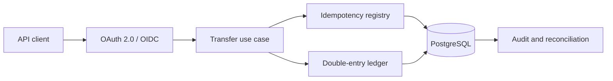

# Secure Ledger API

API de razão financeira com partidas dobradas para plataformas que movimentam créditos internos e precisam impedir cobrança duplicada, saldo negativo por concorrência e alterações sem trilha de auditoria.

> **Estado:** planejamento concluído; implementação ainda não iniciada. Nenhuma funcionalidade descrita abaixo deve ser interpretada como entregue antes de aparecer no histórico e nos releases.

## Problema

Uma plataforma de benefícios, marketplace ou carteira interna pode reenviar a mesma transferência depois de um timeout. Duas operações concorrentes também podem tentar consumir o mesmo saldo. Sem invariantes explícitas, o valor exibido deixa de corresponder ao histórico financeiro.

O projeto manterá um livro-razão imutável. O saldo será calculado a partir de lançamentos vinculados, e cada transferência deverá preservar a igualdade entre débitos e créditos.

## Usuários e resultado esperado

- **Integrações clientes:** repetem uma solicitação com segurança por meio da chave de idempotência.
- **Operação financeira:** reconcilia saldos e localiza divergências sem editar o histórico.
- **Auditoria:** identifica quem iniciou cada operação e quais regras foram aplicadas.
- **Equipe técnica:** reproduz falhas de concorrência e valida correções por testes automatizados.

## Escopo funcional

- cadastrar clientes e contas;
- registrar depósitos, retiradas simuladas e transferências;
- aceitar chave de idempotência em operações de escrita;
- consultar saldo e extrato paginado;
- registrar auditoria sem alterar lançamentos históricos;
- aplicar limites e regras de autorização;
- exportar extrato em formato estruturado;
- reconciliar saldos e identificar inconsistências.

## Arquitetura planejada

O primeiro release será um monólito modular. Os módulos `identity`, `accounts`, `ledger`, `transfers` e `audit` terão fronteiras testadas, mas compartilharão uma transação local quando a consistência exigir atomicidade.

Consulte [a arquitetura](docs/architecture.md) e [o roadmap](docs/roadmap.md).

## Stack planejada

- Java 21 e Spring Boot 3;
- Spring Web, Spring Data JPA, Spring Security e Bean Validation;
- PostgreSQL e Flyway;
- OAuth 2.0/OIDC e JWT;
- JUnit 5, Mockito, AssertJ e Testcontainers;
- REST Assured para contratos HTTP;
- ArchUnit para fronteiras de módulos;
- Docker Compose;
- OpenAPI e Swagger UI como interface navegável da API;
- GitHub Actions.

## Invariantes principais

- a soma de débitos e créditos de uma transação deve ser zero;
- lançamentos confirmados são imutáveis;
- a mesma chave de idempotência e a mesma requisição produzem o mesmo resultado;
- a reutilização da chave com outro conteúdo é rejeitada;
- valores monetários usam precisão decimal e moeda explícita;
- alterações concorrentes não podem gastar o mesmo saldo duas vezes;
- toda resposta de sucesso deve possuir evidência persistida.

## Estratégia de testes

- testes unitários das invariantes do domínio;
- testes de integração com PostgreSQL real por Testcontainers;
- testes concorrentes para transferências simultâneas;
- testes de segurança por escopo e propriedade da conta;
- testes de contrato HTTP e paginação;
- testes de migração do banco;
- reconciliação automatizada após cenários de falha.

## Execução local

Os comandos serão incluídos junto da primeira versão executável. O repositório ainda não contém uma aplicação funcional.

## Roadmap

1. modelo de domínio e invariantes;
2. persistência PostgreSQL e migrações;
3. API REST, validação e tratamento global de erros;
4. idempotência e controle de concorrência;
5. OAuth 2.0/OIDC e autorização;
6. auditoria, reconciliação e observabilidade;
7. Docker, CI e demonstração publicada.

## Demonstração para avaliação técnica

Como este é um produto API-first, a versão executável deverá expor Swagger UI com dados fictícios e um roteiro curto no README. Um avaliador poderá autenticar-se com uma conta de demonstração, criar uma operação idempotente, repetir a mesma requisição para confirmar a proteção contra duplicidade e consultar a trilha de auditoria. O ambiente publicado usará somente dados descartáveis e limites seguros.

## Documentação

- [Arquitetura](docs/architecture.md)
- [Roadmap](docs/roadmap.md)
- [ADR 0001 — monólito modular](docs/adr/0001-monolito-modular.md)
- [Como contribuir](CONTRIBUTING.md)
- [Política de segurança](SECURITY.md)

## Licença

Distribuído sob a licença MIT. Consulte [LICENSE](LICENSE).
