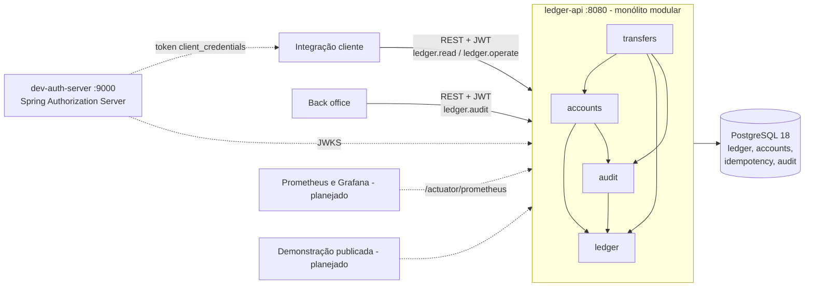

# Secure Ledger API

API de razão financeira com partidas dobradas para plataformas que movimentam créditos internos (carteiras, benefícios, marketplaces) e não podem cobrar em duplicidade, gastar o mesmo saldo duas vezes sob concorrência nem alterar o histórico sem rastro. O repositório entrega um monólito modular em Spring Boot com contas, depósitos, retiradas simuladas, transferências e estornos; chave de idempotência isolada por cliente; saldo e extrato paginado por cursor com exportação CSV; lançamentos imutáveis protegidos por triggers no PostgreSQL; auditoria append-only; reconciliação dos saldos contra os lançamentos; e autorização OAuth 2.0 por escopo e por dono da conta, com um servidor de autorização local e dados fictícios para avaliação.

[](https://github.com/asmeduardo/secure-ledger-api/actions/workflows/ci.yml)
[](https://github.com/asmeduardo/secure-ledger-api/actions/workflows/codeql.yml)
[](LICENSE)


> **Estado:** fases 1 a 4 do [roadmap](docs/roadmap.md) concluídas para execução local. A publicação da demonstração em servidor não foi feita: depende de aprovação do dono do repositório.

## Destaques técnicos

- **Partidas dobradas no domínio e no banco:** `Money` em `BigDecimal` na escala da moeda, sem arredondar; constraint triggers adiados para o commit recusam transações com menos de dois lançamentos ou soma diferente de zero, e chaves estrangeiras compostas mantêm cada lançamento na moeda da conta. São 17 testes de integração gravando SQL direto no banco e 4 propriedades verificadas com 500 casos aleatórios cada ([ADR 0003](docs/adr/0003-partidas-dobradas-garantidas-no-banco.md)).
- **Concorrência sem saldo negativo e sem deadlock:** as contas de cliente são bloqueadas em uma única consulta `ORDER BY id FOR NO KEY UPDATE`. Com saldo de 10,00, 40 retiradas simultâneas de 1,00 resultam em exatamente 10 aceitas e 30 recusadas; 40 transferências cruzadas A→B e B→A terminam sem deadlock. A escolha foi medida: na conta disputada, a alternativa otimista ficou 67% mais lenta, com 1.102 retentativas e 23 requisições abandonadas ([ADR 0004](docs/adr/0004-concorrencia-com-bloqueio-pessimista-ordenado.md)).
- **Idempotência por cliente:** toda escrita exige `Idempotency-Key`, isolada pelo `sub` do token. A repetição devolve a mesma resposta (status, `Location` e corpo) com `Idempotent-Replayed: true`; outro conteúdo com a mesma chave responde `422`; 12 requisições simultâneas com a mesma chave geram um único lançamento ([ADR 0006](docs/adr/0006-idempotencia-por-cliente-e-chave.md)).
- **Histórico imutável:** `UPDATE`, `DELETE` e `TRUNCATE` em lançamentos, transações e auditoria são recusados por trigger, inclusive para o dono da tabela; a correção é um estorno, no máximo um por transação ([ADR 0005](docs/adr/0005-lancamentos-imutaveis-e-estorno.md)).
- **Autorização por escopo e propriedade:** `ledger.read`, `ledger.operate` e `ledger.audit`; JWT validado por assinatura, emissor, audiência e validade. A conta de outro cliente responde o mesmo `404` em `ProblemDetail` que uma conta inexistente ([ADR 0007](docs/adr/0007-autorizacao-por-escopo-e-propriedade.md)).
- **Auditoria e reconciliação:** o evento de sucesso é gravado na mesma transação do efeito; repetições e recusas também ficam registradas com o motivo. A reconciliação (sob demanda e diária) compara saldos materializados e transações com os lançamentos, e o teste injeta divergências direto no banco, uma delas com os triggers desligados ([ADR 0008](docs/adr/0008-auditoria-append-only-e-reconciliacao.md)).
- **Extrato estável:** paginação por cursor que não repete nem pula linhas quando chegam lançamentos novos; exportação CSV RFC 4180 de até 366 dias, em páginas curtas, com neutralização de células que pareçam fórmulas ([ADR 0009](docs/adr/0009-extrato-por-cursor-e-exportacao-csv.md)).
- **Operação:** health e métricas Prometheus (`ledger_operations_total`, `ledger_reconciliation_divergences`), log estruturado ECS no Compose e containers sem root, com sistema de arquivos somente leitura e sem capabilities.
- **Qualidade verificável:** 67 testes unitários (10 deles regras ArchUnit) e 114 de integração com PostgreSQL real via Testcontainers; CI com Spotless, testes e build das imagens, além de CodeQL, dependency review e Dependabot.

## Arquitetura



Os módulos se comunicam pelo pacote `api` de cada um e compartilham uma transação local quando a invariante exige. As linhas tracejadas para baixo são partes planejadas; o endpoint de métricas existe, mas nenhum servidor Prometheus faz parte do Compose. Detalhes, diagrama de sequência e modelo de dados em [docs/architecture.md](docs/architecture.md).

## Stack

| Área | Tecnologias |
| --- | --- |
| Linguagem e framework | Java 25 (LTS), Spring Boot 4.1 |
| API | Spring MVC, Bean Validation, `ProblemDetail` (RFC 9457), OpenAPI 3 e Swagger UI (springdoc-openapi) |
| Persistência | PostgreSQL 18, Spring Data JPA, Hibernate 7, Flyway (migrações SQL com triggers e constraints) |
| Segurança | Spring Security (resource server OAuth 2.0 com JWT), Spring Authorization Server (somente desenvolvimento) |
| Observabilidade | Spring Boot Actuator, Micrometer com registro Prometheus, log estruturado nativo (ECS) |
| Testes | JUnit 6 (Jupiter), Mockito, AssertJ, Testcontainers, ArchUnit |
| Build e qualidade | Maven (wrapper, multimódulo), Spotless, GitHub Actions, CodeQL, dependency review, Dependabot |
| Ambiente local | Docker e Docker Compose |

## Como executar

Pré-requisitos: JDK 25 e Docker. Os comandos abaixo usam um shell POSIX (no Windows, Git Bash).

```bash
cp .env.example .env               # valores de desenvolvimento, usados só na sua máquina
./mvnw -DskipTests package         # gera os jars usados pelas imagens
docker compose up -d --build       # PostgreSQL, dev-auth-server (:9000) e ledger-api (:8080)
docker compose ps                  # aguarde os três serviços ficarem healthy
```

O `ledger-api` sobe com o perfil `demo`, que carrega três contas fictícias: `a1000000-0000-4000-8000-000000000001` (Ana, R$ 1.000,00) e `a1000000-0000-4000-8000-000000000002` (Bruno, R$ 250,00), do cliente `demo-wallet`, e `b2000000-0000-4000-8000-000000000001` (R$ 5.000,00), do cliente `demo-marketplace`. O cliente `demo-auditor` tem o escopo `ledger.audit`.

### Roteiro de avaliação

1. Obtenha um token do `demo-wallet` (o segredo é o do `.env`):

   ```bash
   TOKEN=$(curl -s -u demo-wallet:local-dev-only-wallet \
     -d grant_type=client_credentials -d "scope=ledger.read ledger.operate" \
     http://localhost:9000/oauth2/token | sed -E 's/.*"access_token":"([^"]+)".*/\1/')
   ```

2. Transfira R$ 150,00 da Ana para o Bruno com uma chave de idempotência:

   ```bash
   transfer() {
     curl -s -i -X POST http://localhost:8080/api/v1/transfers \
       -H "Authorization: Bearer $TOKEN" -H "Content-Type: application/json" \
       -H "Idempotency-Key: demo-transfer-0001" \
       -d "{\"sourceAccountId\":\"a1000000-0000-4000-8000-000000000001\",
            \"destinationAccountId\":\"a1000000-0000-4000-8000-000000000002\",
            \"amount\":\"$1\",\"currency\":\"BRL\"}"
   }
   transfer 150.00    # 201 Created com os dois lançamentos e o saldo após cada um
   ```

3. Repita a mesma requisição: a resposta é idêntica, traz `Idempotent-Replayed: true` e nenhum dinheiro se move de novo. Com outro valor e a mesma chave, a resposta é `422 idempotency-key-reused`:

   ```bash
   transfer 150.00
   transfer 151.00
   ```

4. Veja a trilha de auditoria do cliente: `SUCCEEDED`, `REPLAYED` e `REJECTED` para a mesma chave, com o motivo da recusa:

   ```bash
   curl -s -H "Authorization: Bearer $TOKEN" "http://localhost:8080/api/v1/audit-events?limit=5"
   ```

Para continuar pela interface, abra o Swagger UI em <http://localhost:8080/swagger-ui/index.html>, clique em **Authorize** e cole o token (vale 15 minutos). A coleção [`http/secure-ledger.http`](http/secure-ledger.http), para o IntelliJ HTTP Client ou a extensão REST Client do VS Code, cobre também extrato, exportação CSV, estorno, a conta de outro cliente (`404`) e, com o token do `demo-auditor`, a trilha completa e a reconciliação. Health e métricas ficam em <http://localhost:8080/actuator/health> e <http://localhost:8080/actuator/prometheus>.

Para encerrar e apagar os dados: `docker compose down -v`. Se a porta 5432 ou 8080 estiver ocupada, ajuste `POSTGRES_PORT` ou `LEDGER_API_PORT` no `.env`; a porta 9000 do servidor de autorização é fixa porque compõe o emissor dos tokens.

## Testes

```bash
./mvnw verify
```

É o mesmo comando do CI e exige o Docker em execução. Ele verifica a formatação (Spotless) e roda 67 testes unitários e 114 de integração:

| Camada | O que comprova | Quantidade |
| --- | --- | ---: |
| Domínio (unitários) | `Money` (escala da moeda, sem arredondar, moedas aceitas), saldo nunca negativo, partidas dobradas, estorno e 4 propriedades com 500 casos aleatórios cada | 37 |
| Aplicação (unitários e Mockito) | fluxo da idempotência (repetição, chave reutilizada, corrida perdida), impressão digital da requisição, cursor e paginação da exportação | 20 |
| Arquitetura (ArchUnit) | fronteiras entre módulos, camadas, ausência de ciclos e nenhum `BigDecimal` criado de `double` | 10 |
| Banco (Testcontainers) | constraints, soma zero e mínimo de dois lançamentos no commit, lançamento tardio, `UPDATE`/`DELETE`/`TRUNCATE` recusados | 17 |
| Razão e concorrência | lançamentos atômicos, saldo e estorno no serviço; débitos simultâneos, transferências cruzadas e liquidação compartilhada | 10 |
| API REST | contas, depósitos, retiradas, transferências, estornos, extrato, exportação CSV e contrato OpenAPI | 36 |
| Idempotência | repetição, conflito, outra operação, isolamento por cliente, 12 requisições simultâneas e chave obrigatória | 8 |
| Segurança | `401`, `403` por escopo, JWT com chave RSA gerada no teste (assinatura, emissor, audiência, expiração) | 14 |
| Auditoria e reconciliação | eventos de sucesso, repetição e recusa, imutabilidade, back office e divergências injetadas no banco | 14 |
| Observabilidade e demonstração | health, métricas Prometheus, dados fictícios que reconciliam e carga idempotente | 9 |
| Servidor de autorização | tokens com audiência e escopos, escopo negado, segredo no corpo e segredo errado | 6 |

Os testes de integração compartilham um contexto Spring e um PostgreSQL por execução; cada teste cria as próprias contas e não depende de tabelas vazias. A medição de bloqueio (`LockingStrategyBenchmark`) fica fora da suíte e roda sob demanda, como descrito na [ADR 0004](docs/adr/0004-concorrencia-com-bloqueio-pessimista-ordenado.md). Para corrigir a formatação, use `./mvnw spotless:apply`.

## Estrutura do projeto

```text
.
├── ledger-api/                 API (:8080)
│   └── src/main/java/.../secureledger/
│       ├── ledger/             partidas dobradas, saldos, bloqueios, extrato e integridade
│       ├── accounts/           contas do cliente, propriedade, extrato e exportação CSV
│       ├── transfers/          depósitos, retiradas, transferências e estornos
│       ├── audit/              trilha append-only, reconciliação e job diário
│       ├── shared/             Money, erros, segurança, idempotência, cursor e OpenAPI
│       └── demo/               dados fictícios do perfil demo
│   └── src/main/resources/db/migration/   migrações Flyway V1 a V5
├── dev-auth-server/            servidor de autorização OAuth 2.0 para desenvolvimento (:9000)
├── http/                       exemplos de requisições
├── docs/                       arquitetura, roadmap e ADRs
├── Dockerfile                  imagem de cada módulo, com usuário sem privilégios
└── compose.yaml                PostgreSQL, dev-auth-server e ledger-api
```

Dentro de cada módulo, `domain` concentra entidades e regras, `application` os casos de uso e transações, `web` os controllers e `api` o que outros módulos podem usar.

## Decisões

- [ADR 0001](docs/adr/0001-monolito-modular.md): monólito modular com transação local onde a contabilidade exige atomicidade.
- [ADR 0002](docs/adr/0002-stack-base.md): Java 25, Spring Boot 4.1, Maven multimódulo e observabilidade nativa do Boot.
- [ADR 0003](docs/adr/0003-partidas-dobradas-garantidas-no-banco.md): partidas dobradas no domínio e no banco, com constraint triggers adiados e chaves compostas de moeda.
- [ADR 0004](docs/adr/0004-concorrencia-com-bloqueio-pessimista-ordenado.md): bloqueio pessimista em ordem de id, escolhido por medição contra o otimista.
- [ADR 0005](docs/adr/0005-lancamentos-imutaveis-e-estorno.md): lançamentos imutáveis por trigger e correção apenas por estorno.
- [ADR 0006](docs/adr/0006-idempotencia-por-cliente-e-chave.md): chave de idempotência por cliente em toda escrita, com resposta gravada.
- [ADR 0007](docs/adr/0007-autorizacao-por-escopo-e-propriedade.md): escopos OAuth 2.0, propriedade da conta e `404` que não revela contas de terceiros.
- [ADR 0008](docs/adr/0008-auditoria-append-only-e-reconciliacao.md): auditoria append-only atômica com o efeito e reconciliação dos saldos.
- [ADR 0009](docs/adr/0009-extrato-por-cursor-e-exportacao-csv.md): extrato por cursor e exportação CSV consistente.

## Roadmap

| Fase | Conteúdo | Situação |
| --- | --- | --- |
| 1. Domínio | `Money`, contas, transações, lançamentos, partida dobrada e testes de propriedade | concluída |
| 2. Persistência e API | PostgreSQL, Flyway, API REST, `ProblemDetail`, OpenAPI e Testcontainers | concluída |
| 3. Confiabilidade | idempotência, concorrência, estorno, auditoria, reconciliação e extrato | concluída |
| 4. Segurança e operação | OAuth 2.0 com escopos e propriedade, métricas, logs, Compose, CI e análise estática | concluída, exceto a publicação da demonstração em servidor |

Próximos passos ainda não iniciados: papel de banco de runtime sem posse das tabelas, limites por operação, retenção das chaves de idempotência e reconciliação incremental. O detalhamento está em [docs/roadmap.md](docs/roadmap.md). Para contribuir, veja [CONTRIBUTING.md](CONTRIBUTING.md); para relatar vulnerabilidades, [SECURITY.md](SECURITY.md).

## Licença

Distribuído sob a licença MIT. Consulte [LICENSE](LICENSE).
