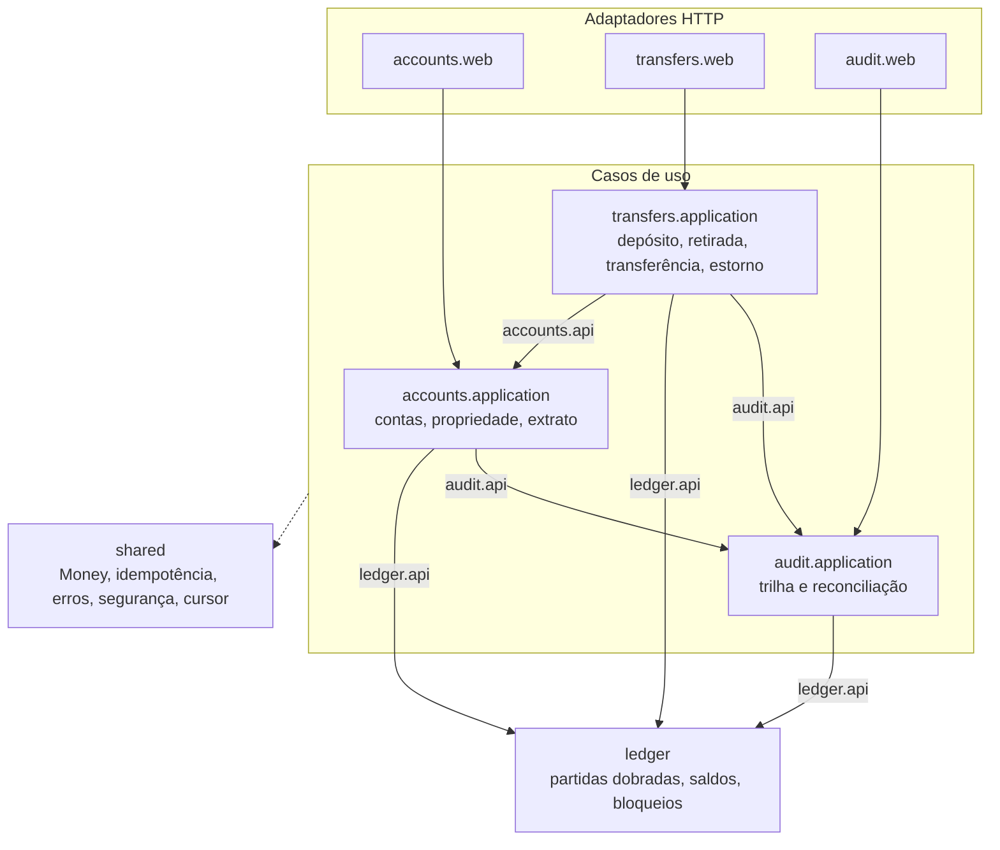
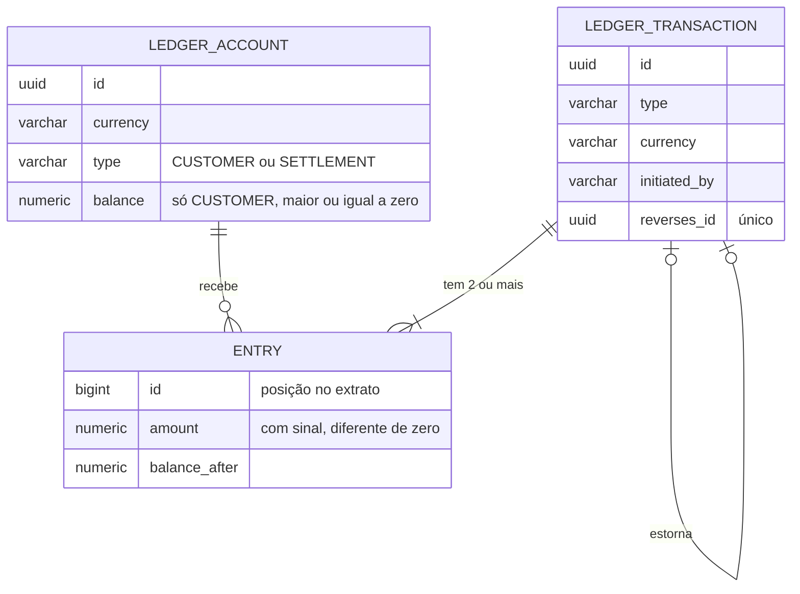

# Arquitetura

## Visão geral

O `ledger-api` é um monólito modular ([ADR 0001](adr/0001-monolito-modular.md)): um processo Spring Boot, um banco PostgreSQL e uma transação local sempre que uma invariante contábil exige atomicidade. Os módulos são pacotes com fronteiras verificadas por ArchUnit e falam entre si apenas pelo pacote `api` de cada um. O `dev-auth-server` é um processo separado, só para desenvolvimento, que emite os tokens JWT ([ADR 0007](adr/0007-autorizacao-por-escopo-e-propriedade.md)).



| Módulo | Responsabilidade | Schema |
| --- | --- | --- |
| `ledger` | contas do razão (cliente e liquidação), transações, lançamentos, bloqueio e saldo, extrato, verificação de integridade | `ledger` |
| `accounts` | contas como o cliente as vê (dono e nome), propriedade, extrato paginado e exportação | `accounts` |
| `transfers` | depósitos, retiradas simuladas, transferências, estornos e consulta de transação | — |
| `audit` | trilha append-only, combinação de idempotência com auditoria (`AuditedWrites`), reconciliação e job diário | `audit` |
| `shared` | `Money`, erros de negócio e `ProblemDetail`, segurança, idempotência, paginação por cursor, OpenAPI, relógio | `idempotency` |
| `demo` | carga dos dados fictícios no perfil `demo` | — |

Regras verificadas por `ModuleBoundariesTest`: sem ciclos entre módulos; `ledger` não depende de nenhum outro módulo; `ledger`, `accounts` e `audit` são usados de fora apenas pelo pacote `api`; `shared` não conhece módulos de negócio; `domain` não depende de `application`, `web` ou segurança; controllers não usam repositórios; nenhum `BigDecimal` é construído a partir de `double`.

Não há chaves estrangeiras entre schemas: `accounts.customer_account` e `ledger.ledger_account` compartilham o mesmo id, e a consistência entre elas vem da transação local que abre a conta.

## Modelo contábil

- Toda transação tem dois ou mais lançamentos em uma moeda, com valores com sinal (crédito positivo, débito negativo) que somam zero ([ADR 0003](adr/0003-partidas-dobradas-garantidas-no-banco.md)).
- **Depósito:** débito na conta de liquidação da moeda, crédito na conta do cliente. **Retirada simulada:** o inverso; nenhum dinheiro sai do sistema. **Transferência:** débito na origem, crédito no destino, ambas do mesmo cliente. **Estorno:** os lançamentos opostos de uma transação ([ADR 0005](adr/0005-lancamentos-imutaveis-e-estorno.md)).
- A conta de cliente guarda o saldo materializado, nunca negativo; cada lançamento guarda o saldo logo depois dele. A conta de liquidação não guarda saldo nem é bloqueada.
- Lançamentos, transações e eventos de auditoria são append-only no banco.



## Fluxo de uma transferência

```mermaid
sequenceDiagram
    participant C as Cliente
    participant API as MovementController
    participant W as AuditedWrites
    participant I as Idempotency
    participant L as Ledger
    participant DB as PostgreSQL
    C->>API: POST /api/v1/transfers + JWT + Idempotency-Key
    API->>W: transfer(cliente = sub, chave, comando)
    W->>I: execute
    I->>DB: busca (cliente, chave)
    alt chave já usada com o mesmo conteúdo
        DB-->>I: resposta gravada
        I-->>W: replay
        W->>DB: evento REPLAYED (transação própria)
        W-->>C: 201 + Idempotent-Replayed: true
    else chave nova
        I->>DB: BEGIN; INSERT da chave (espera se outra requisição a reservou)
        I->>L: transfer (contas do cliente verificadas antes)
        L->>DB: SELECT contas ORDER BY id FOR NO KEY UPDATE
        L->>DB: INSERT transação e lançamentos; UPDATE saldos
        W->>DB: evento SUCCEEDED
        I->>DB: grava a resposta; COMMIT (triggers conferem a soma zero)
        W-->>C: 201 + Location
    end
```

Se uma regra recusa a operação (saldo insuficiente, conta de outro cliente, moeda divergente), a transação inteira é desfeita, inclusive a chave, e um evento `REJECTED` com o código do problema é gravado em transação própria.

## Contratos HTTP

- Controllers tratam HTTP e validação; serviços controlam transações e devolvem records imutáveis. Entidades JPA não saem da aplicação.
- Valores monetários trafegam como strings decimais na escala da moeda (`"10.50"`), com a moeda explícita.
- Erros seguem a RFC 9457 (`application/problem+json`) com tipos `urn:secure-ledger:problem:<código>`; cada exceção de negócio declara o próprio código e uma categoria (`INVALID`, `NOT_FOUND`, `CONFLICT`, `UNPROCESSABLE`) traduzida em status pela camada web.
- Extrato e trilha de auditoria paginam por cursor; a listagem de contas, por página ([ADR 0009](adr/0009-extrato-por-cursor-e-exportacao-csv.md)).

## Operação

- **Observabilidade:** `/actuator/health` (com probes de liveness e readiness, incluindo o banco) e `/actuator/prometheus` são públicos; os demais endpoints do Actuator não são expostos. Métricas próprias: `ledger_operations_total{operation, outcome}` e `ledger_reconciliation_divergences`. No Compose, o log sai em JSON no formato ECS, com as contagens da reconciliação como campos.
- **Containers:** uma imagem por módulo, com as camadas do Spring Boot e usuário 10001; o PostgreSQL roda como o usuário `postgres`. Os containers das aplicações usam sistema de arquivos somente leitura, sem capabilities do Linux e com `no-new-privileges`. As portas são publicadas apenas em `127.0.0.1`.
- **Não implementado:** papel de banco de runtime sem posse das tabelas ([ADR 0005](adr/0005-lancamentos-imutaveis-e-estorno.md)), limites por operação, retenção das chaves de idempotência, reconciliação incremental, servidor Prometheus/Grafana e publicação da demonstração em servidor.
